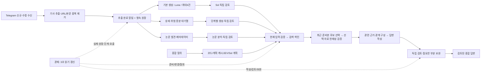

# 실시간 수집·분석·질의 구조

기준일: 2026-10-18. 목표는 새 자료가 과거 적체 뒤에서 기다리는 시간을 없애고, 이미 검토된 근거를 질의에 빨리 제공하는 것이다. 모델 자체의 생성 시간을 실시간 UI 갱신이나 검색 캐시 시간으로 바꾸어 보고하지 않는다.

## 확인한 병목과 구현

| 병목 | 구현 | 보존하는 계약 |
|---|---|---|
| 추출 후 5분 예약 시각까지 대기 | 추출 완료 알림으로 dispatcher 즉시 호출, 기존 예약은 누락 복구 | 중복 owner/파일 잠금, 사용자 중지와 제공자 제한 |
| 큰 기본 run이 끝나거나 보류가 해결될 때까지 새 기사 대기 | 배치 체크포인트에서 새 고정 스냅샷으로 인계, 새 입력 우선 | 이전 고정 대상 수·거절·attempts·근거 스냅샷 보존 |
| 기사마다 생성·검토 2회, 작업자2 | 짧은 기사 최대4건·원문 합계7,200자·작업자4, 재시도는1건 | 기사별 인용과 독립 검토, 실패 항목만 보완 |
| 검토 중 연결 장애에서 같은 초안 재생성 | 입력·프롬프트·모델 정책에 묶인 미공개 생성 체크포인트 | 검토 통과 전 공개 금지, 의미 거절은 초안 재사용 금지 |
| 상세 사이클의 다음 30분 구간까지 신규 입력 대기 | 추출 토큰을 실행 중 확인해 증분 입장 | 처리 중인 입력은 완료 체크포인트까지 보류, 동일 실패 예산 유지 |
| 일시중지 논문이 전체 입장 용량 차지 | 실행/대기 논문만 용량에 계산 | 해당 논문의 중지를 자동 해제하지 않음, 공급자별 Retry-After 유지 |
| 기본 분석 변경마다 전체 검색 자료 재입장 | 변경 원장과 정확한 워터마크로 기본 분석의 변경/삭제만 갱신 | 원문·다른 분석·정정·정책·스키마 변경은 전체 검증으로 복귀 |
| 자료 변경 시 검색 준비·질의 재시도 반복 | 한 읽기 스냅샷으로 준비를 끝내고, 2분 이내 준비본에서 선택한 자료를 현재 공개 기준으로 다시 입장 | 다른 기사의 갱신과 선택한 근거의 변경을 구분. 입력·철회·인용 원문·독립 검토가 달라지면 재검토 |
| 완료 답변 조회마다 전체 기사 입력 재계산 | 커밋된 source 세대·정책별 입력 목록을 최대2개 재사용, 실제 답변 근거의 의존성만 재확인 | 원문/정책/철회 변경은 캐시 무효화, 검토 기준 동일 |
| 같은 URL의 관측 순서가 프로세스마다 다름 | 인용과 동일 ID 노드의 내용까지 결정적으로 정렬 | 저장 검토 이력·의미는 그대로 유지, 거짓 변경 판정 방지 |
| 관제에서 검색 반영·종합 질의 단계가 빠짐 | 전체 흐름을 화면 상단에 배치, 10단계·작업 큐·실제 호출 표시 | 실제 owner 없는 running 행은 동작 애니메이션 금지 |

## 모델 역할

- 코드: URL 보존·중복 제거·현재 입력 해시·인용 형식·캐시 의존성·입장/재시도 예산. 이 작업에는 모델을 호출하지 않는다.
- JEV: 선택지가 준비된 검색 계획 선택. 변화/우선순위 외에 벤치마크 방법·데이터세트·이슈를 명시한 연구 현황 질의를 지원한다. 낮은 확신도, 복합 조건, 한도/오류는 기존 Sol 계획으로 돌아간다. 확신도는 사실 정확도나 미래 사건 확률이 아니다.
- Luna: 기본 기사 초안과 기존 정책상 허용된 통합 초안. 기존 최신 모델 `gpt-6-luna`를 유지한다.
- Sol: 독립 검토, 일반 종합 답변, 복잡한 계획. `gpt-6.1-sol`을 유지한다.
- Astra: 기존의 고위험/복잡한 분석 정책에 따른 심화 작업. 모든 기사/질문에 추가하지 않는다.

JEV 키워드 후보 정리는 `NEWS_BASELINE_KEYWORDS_MODE=jev`로 별도 시험할 수 있으나 기본은 `off`이다. 실제 원문을 쓰거나 검토를 통과시키는 기능이 아니며, 명확히 잘린 후보를 제거하는 제한된 기능이다. 매 기사에 추가 호출을 강제하지 않는다.

## 목표 시간과 실제 측정의 구분

새 메시지 수신은 Telegram long polling 응답 및 네트워크에 의존한다. 추출 알림 후 예약 대기, 기사별 생성/검토, 검색 반영, 질의 첫 근거, 최종 답변을 각각 측정한다. 독립 검토가 필요한 상세 답변을 무조건 몇 초 이내에 완료한다고 보장하지 않는다. 사용량 제한·실패·자료 변경은 관제에 별도 표시한다.

같은 실제 기사16건, 별도 빈 원장으로 실행한 첫 비교:

| 측정 | 기존 작업자2/1건 | 새 작업자4/최대4건 |
|---|---:|---:|
| 실행 시간 | 120.244초 | 40.148초 |
| 실제 모델 호출 | 34회 | 12회 |
| 제공자 보고 입력 토큰 | 229,554 | 94,865 |
| 제공자 보고 출력 토큰 | 9,123 | 5,969 |
| 검토 통과 | 16건 | 15건 |
| 검토 보류 | 0건 | 1건 |

검토 통과 기사 처리량은 약2.8배, 입력 토큰은 약58.7% 감소했다. 새 방식의 검토 보류1건을 완료로 세지 않았다. 순차 비교이며 제공자 부하·캐시·모델 변동은 통제하지 못했고 표본16건으로 일반화된 품질 동등성을 입증하지 않는다. 실행 시간3배는 개별 기사/종합 답변의 응답 시간3배를 뜻하지 않는다. 근거: `.runtime/verification/execution-ab-20261018.json`.

종합 질의는 자료 준비 시점과 선택한 자료의 현재성 검사를 구분한다. 갱신 중 후보 검색에는 2분 이내 준비본을 사용할 수 있으며, 이후 들어온 새 자료는 해당 후보 집합에 없을 수 있다. 실제 답변에 사용하는 자료는 생성 전과 공개·조회 때 입력 해시·인용·독립 검토·철회를 재확인한다. 원문 보강 문단은 전체 원문 해시도 확인한다. 범위나 노드를 지정한 질의는 이 대체 경로로 범위를 넓히지 않는다. 답변 화면에 준비 시점을 표시한다.

추가 운영 검증에서는 수정 전 질의가421.054초에 검색 준비 시간 초과로 끝났다. 중간 수정은 생성·검토 원장상230.025초에 완료했지만 완료 조회가60초를 초과했으므로 전달 성공으로 보고하지 않는다. 전체 입력 재계산과 과도한 후보 의존성을 보완한 후, 준비된 검색 자료에서 첫 원문0.098초·최종 전달108.622초·현재 근거를 재확인한 조회0.389초를 확인했다. 실제 독립 검토의 설명/통합/범위 기준 통과, 주장8개이며 한 번의 동일 근거 재확인은 생성/검토 캐시를 사용했다. 서버 재기동 뒤 준비 대기230.521초는 질의 실행 시간에 포함되지 않는다. 같은 시각의 부하를 통제한 A/B가 아니므로 전체 질의2배 보장으로 해석하지 않는다. 근거: `realtime-query-20261018{,-v2,-v3}.json`. 관측 정렬 보완 후에는 준비 대기15.661초(별도), 첫 원문0.098초·최종 전달122.367초·검증 후 조회0.295초와 독립 검토 passed를 확인했다. 두 최종 실행의 소요 시간 차이를 측정 오차 없이 동일 성능으로 일반화하지 않는다. 근거 `realtime-query-20261018-v4.json`.

## 운영과 회귀 기준

1. 수집·추출 완료 후 신규 입력이 다음5분 타이머를 기다리지 않는가.
2. 새 입력 인계 시 이전 실행의 고정 분모와 동일 입력 attempts가 그대로인가. 사용자/엔진 중지가 자동 해제되지 않는가.
3. 네트워크 검토 중단 후 초안을 재생성하지 않고 독립 검토를 완료하는가. 의미 거절은 올바르게 재생성하는가.
4. 상세 실행 중 새 기사 추가, 처리 중 기사 수정, 사용자 중지를 구분하는가.
5. 증분 검색과 전체 재검증의 결과가 같은가. 삭제·철회·원문 수정·정정·정책 변경은 누락 없이 반영되는가.
6. 동시 쓰기 중 다른 기사의 변화로 답변이 재시작되지 않는가. 선택한 자료·원문·정책 변경과 철회는 재검토 대상인가.
7. 관제에서 실제 소유자, 대기·실행·보류, 검색 반영, 질의 단계가 갱신되는가. 조회만으로 분석 POST가 발생하지 않는가.

구현은 SQLite 기반의 단일 호스트 운영을 유지한다. 메시지 브로커/벡터 DB를 추가하면 자동으로 빨라진다고 가정하지 않는다. 이후 확대 시에는 검토 결과의 변경 원장을 상세·논문에도 확장하고, 동일 기사에서 이미 검토한 사실을 중복 생성하는 부분을 근거/정책별로 재사용하는 순서가 적절하다.

참고: [OpenAI 지연 최적화](https://developers.openai.com/api/docs/guides/latency-optimization), [TypeSafe JEV 인터페이스](https://docs.typesafe.ai/introduction). 외부 자료의 일반 원칙과 이 저장소의 실제 측정값을 구분한다.
